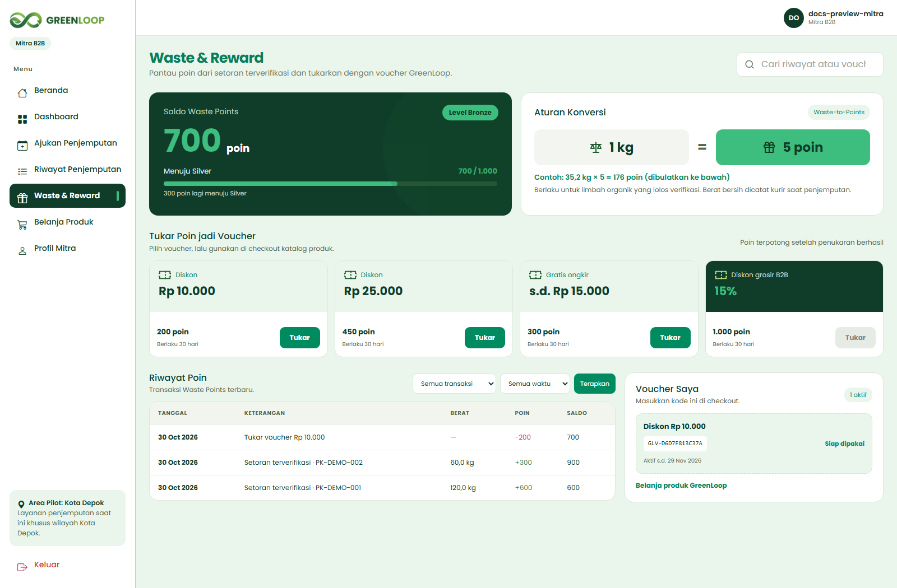
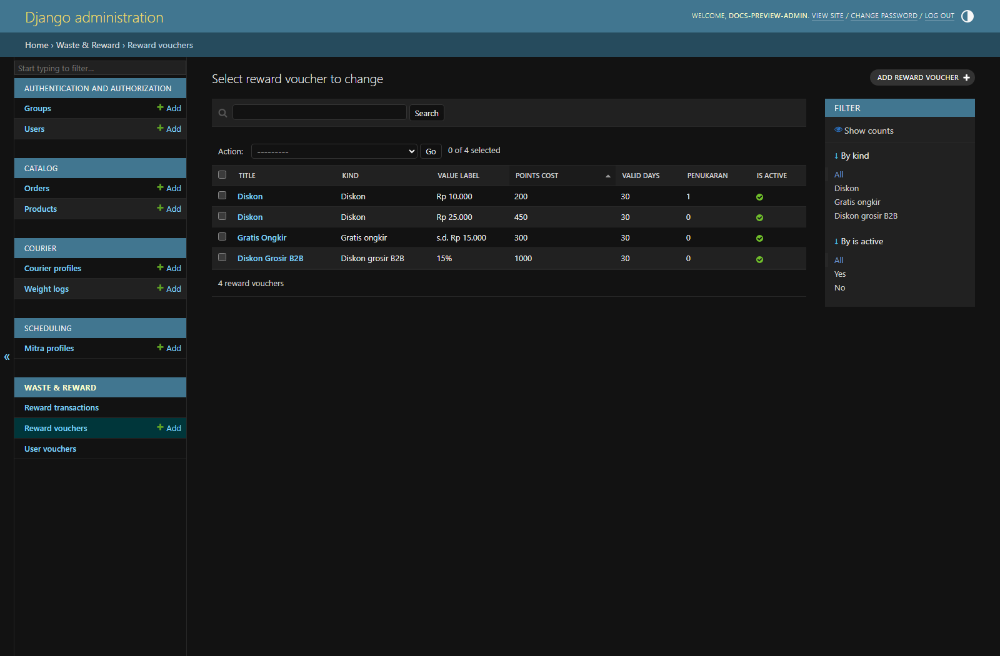

# GreenLoop

## 1. Nama Aplikasi

**GreenLoop**

## 2. Anggota Kelompok

- ANDY AULIA AKBAR - 2506613590
- BANIN SHULA AFIQAH ARADENA - 2506604794
- FILZA SHAFIRA - 2506623641
- RAFATA ZAHI CHERIE - 2506621592
- MUHAMMAD FAYADH AZZAHRAN - 2506586961

## 3. Deskripsi Aplikasi Web

GreenLoop adalah sebuah platform aplikasi web terintegrasi berbasis ekonomi sirkular (*circular economy*) yang bertindak sebagai pusat kendali digital untuk menghubungkan manajemen logistik penjemputan limbah organik dengan toko *e-commerce* produk pembersih ramah lingkungan.

Platform ini beroperasi dengan memfokuskan layanan awal pada satu wilayah kota percontohan (*pilot project*) berskala mikro yang terdata menyumbang volume limbah organik terbesar.

Sistem aplikasi web ini bekerja menggunakan satu basis data terpusat (*centralized database*) dengan halaman dan akses yang disesuaikan untuk Mitra, Kurir, Admin, Konsumen, dan pengunjung publik:

1. **Dashboard Mitra B2B (Cafe/Hotel)**
   Menyediakan fitur *Smart Pick-Up Scheduler* untuk menjadwalkan penjemputan limbah secara digital serta melacak akumulasi poin reward (*Waste-to-Points*).

2. **Dashboard Kurir (Mobile-Responsive)**
   Terintegrasi langsung dengan OpenStreetMap untuk menyajikan navigasi rute perjalanan penjemputan paling optimal di wilayah operasional guna efisiensi bahan bakar, sekaligus menyediakan form input berat sampah (kg) secara *real-time* di lapangan.

3. **Dashboard Admin**
   Mengelola verifikasi pickup dan kurir serta administrasi katalog produk dan voucher.

4. **E-Commerce & Live Impact Dashboard (Publik)**
   Berfungsi sebagai etalase penjualan retail (*B2C*) maupun grosir (*B2B* amenitas hotel) dari produk sabun mandi batang estetis dan sabun cuci piring alami yang diproduksi secara mandiri oleh tim kami menggunakan cairan hasil fermentasi *eco-enzyme* dari limbah organik tersebut.

   Halaman utama web juga menampilkan grafik dinamis statistik riil jumlah sampah yang berhasil diselamatkan demi transparansi dampak lingkungan.

### Value Proposition (VP) Analysis

#### 1. What are the purposes/visions of this website?

- **Visi & Tujuan Utama:** Membangun ekosistem tata kelola sampah organik digital yang efisien, modern, dan menguntungkan melalui pendekatan teknologi perputaran tertutup (*closed-loop system*).
- Website ini bertujuan mendigitalisasi rantai pasok sampah yang awalnya berantakan menjadi lebih terorganisir, sekaligus menjadi wadah komersialisasi produk turunan ramah lingkungan demi mewujudkan lingkungan perkotaan yang bebas dari penumpukan limbah berbahaya.

#### 2. What problems will this website solve?

- **Problem Logistik Terfragmentasi:** Kurangnya sistem penjemputan limbah organik khusus dari sektor komersial secara terjadwal, sehingga sampah menumpuk dan memicu emisi gas metana di TPA akibat tercampur dengan sampah anorganik.
- **Problem Transparansi & Insentif:** Pelaku bisnis kuliner/hotel jarang memilah sampah mereka karena tidak ada sistem insentif yang menguntungkan dan tidak adanya visualisasi data kontribusi lingkungan mereka.
- **Problem Pencemaran Air:** Tingginya ketergantungan masyarakat dan industri terhadap produk pembersih berbasis bahan kimia sintetis keras yang merusak ekosistem air bawah tanah.

#### 3. Whom will this website help?

Aplikasi web ini memberikan dampak dan bantuan langsung kepada tiga pilar pengguna (*User Roles*):

- **Sektor Bisnis Kuliner & Akomodasi (Cafe & Hotel):** Membantu mereka mengelola limbah dapur secara higienis, menekan emisi karbon operasional, sekaligus memfasilitasi kebutuhan amenitas hotel ramah lingkungan.
- **Tim Kurir Lapangan:** Memudahkan pencatatan berat sampah digital tanpa kertas nota manual dan memberikan navigasi rute jalan terpendek agar kerja lebih efisien.
- **Konsumen Umum & Eco-Enthusiast (Masyarakat Urban):** Membantu mereka mendapatkan produk pembersih kulit dan peralatan dapur alami yang aman, premium, serta terbukti berkontribusi langsung pada penyelamatan lingkungan.

#### 4. How will this website help them?

- **Bagi Cafe & Hotel:** Sistem web mengotomatisasi pengangkutan limbah mereka melalui pengingat jadwal penjemputan digital. Setiap sampah yang disetor dikonversi otomatis oleh web menjadi poin ekonomi (*Waste Points*) yang dapat mereka gunakan sebagai voucher potongan harga untuk membeli kembali sabun dari platform. Web juga menyediakan *Live Tracker Data* dampak lingkungan untuk menaikkan *branding* bisnis hijau mereka.
- **Bagi Kurir:** Integrasi OpenStreetMap langsung di browser HP kurir membantu mengarahkan jalan secara berurutan dari satu cafe ke cafe lain agar tidak membuang waktu dan BBM di kemacetan kota.
- **Bagi Konsumen Umum:** Menyediakan modul *e-commerce* modern yang memudahkan transaksi digital untuk membeli sabun hasil produksi kita.

## 4. Perbandingan dengan Aplikasi Serupa

| Fitur / Fitur Utama | Aplikasi Pengelolaan Limbah (Waste4Change, Rekosistem, MallSampah) | Platform E-Commerce Ramah Lingkungan (Demi Bumi, Lemonilo) | GreenLoop |
|---|---|---|---|
| Penjemputan Limbah Organik B2B | ✓ | ✗ | ✓ |
| Penjadwalan Otomatis (*Smart Pick-Up*) | ✓ | ✗ | ✓ |
| Navigasi Rute Kurir Terintegrasi | ✓ | ✗ | ✓ |
| Sistem Reward Insentif (*Waste-to-Points*) | ✓ | ✗ | ✓ |
| E-Commerce Produk Olahan Sendiri (Eco-Enzyme) | ✗ | ✓ | ✓ |
| Penggunaan Poin Sampah untuk Belanja Produk | ✗ | ✗ | ✓ |
| Visualisasi Dampak Lingkungan (*Live Impact*) | sebagian | ✗ | ✓ |

Keunggulan utama GreenLoop dibanding aplikasi yang ada di pasaran adalah integrasi *closed-loop system* dalam satu platform. Aplikasi pengelolaan sampah yang ada seperti Waste4Change dan Rekosistem umumnya berfokus pada logistik penjemputan limbah tanpa menyediakan produk turunan langsung, sementara platform e-commerce biasa seperti Demi Bumi hanya menjual produk tanpa memiliki sistem pasokan bahan baku dari olahan limbah sendiri.

Dengan GreenLoop, Mitra B2B tidak hanya menyetor limbah organik, tetapi juga mendapatkan poin reward (*Waste-to-Points*) yang dapat diputar kembali untuk membeli produk pembersih alami (*eco-enzyme*) hasil olahan limbah tersebut. Integrasi ini menciptakan ekosistem ekonomi sirkular yang utuh, transparan, dan saling menguntungkan.

## 5. Modul dan PIC

| Modul | Scope Pekerjaan | PIC |
|---|---|---|
| **Authentication, User & Base UI** | • Mengelola fitur pendaftaran akun (*register*), masuk sistem (*login*), keluar (*logout*), dan pengelolaan profil pengguna.<br>• Menerapkan pembatasan hak akses halaman berbasis peran (*Role-Based Access Control*).<br>• Membuat kerangka tampilan utama aplikasi (*base template*, navbar, footer, dan sistem navigasi utama).<br>• Menampilkan Live Impact Dashboard (grafik visual interaktif statistik total sampah terkumpul dan reduksi emisi karbon) pada halaman depan (*Home Page* / Publik). | Afiqah |
| **Mitra & Pickup Scheduling** | • Menyediakan halaman *Dashboard* khusus untuk pengguna berstatus Mitra B2B (kafe, restoran, hotel).<br>• Fitur kalender digital jadwal penjemputan sampah organik (*Smart Pick-Up Scheduler*).<br>• Kolom pengisian estimasi volume limbah harian untuk menentukan jenis armada.<br>• *Digital Image Validation*: Mitra wajib mengunggah foto kualitas limbah kulit buah/sayur segar mereka di web. Kurir hanya akan ditugaskan berangkat jika foto tersebut sudah diverifikasi dan disetujui (*Approved*) oleh admin di sistem. Jika foto menunjukkan sampah tidak layak, pesanan ditolak secara digital sejak awal di web tanpa membuang bensin kurir.<br>• Menyediakan tabel pemantauan riwayat dan status penjemputan. | Filza |
| **Courier & Route Management** | • Menyediakan halaman *Dashboard* khusus kurir lapangan berbasis tampilan seluler responsif (*mobile-responsive*).<br>• Mengintegrasikan OpenStreetMap untuk memetakan lokasi mitra yang sudah lolos verifikasi foto secara otomatis dan menampilkan rute perjalanan penjemputan paling optimal secara berurutan.<br>• Menyediakan tombol kendali kurir (Mulai Perjalanan, Selesai Pikap) dan formulir digital untuk menginput data berat bersih sampah (kg) secara *real-time* langsung di lokasi penjemputan. | Rafata |
| **Waste & Reward System** | • Mengelola komputasi backend untuk pemrosesan basis data limbah organik yang masuk.<br>• Bertanggung jawab atas jalannya fungsi algoritma otomatis konversi berat sampah menjadi poin ekonomi (*Waste-to-Points System*).<br>• Mencatat riwayat perolehan poin mitra.<br>• Menyediakan modul sistem penukaran poin menjadi voucher atau kupon potongan harga belanja produk sabun di platform. | Akbar |
| **E-Commerce** | • Mengelola seluruh alur toko online publik untuk penjualan ritel (*B2C*) maupun grosir (*B2B* untuk fasilitas/amenitas hotel).<br>• Menampilkan halaman katalog produk, detail deskripsi produk sabun premium (kemasan *aluminum foil stand pouch*), keranjang belanja (*cart*), dan halaman *checkout/order* otomatis.<br>• Mengintegrasikan gerbang pembayaran digital otomatis via Midtrans API (QRIS/E-Wallet/VA Bank).<br>• Mengintegrasikan kalkulator perhitungan biaya ongkos kirim otomatis via RajaOngkir API berdasarkan berat produk. | Fayadh |

## 6. Public API

Layanan eksternal yang benar-benar dipanggil aplikasi:

- **OpenStreetMap tile server** - Menampilkan peta dasar dan tile peta pada halaman lokasi.
- **Nominatim** - Mencari lokasi dan mengubah koordinat menjadi alamat/wilayah pada profil mitra.
- **OSRM** - Menghitung rute jalan dan urutan perjalanan kurir; endpoint bawaan yang dipakai tercantum di `courier/maps.py`.
- **Open-Meteo** - Menampilkan prakiraan cuaca untuk halaman rute kurir.
- **Midtrans Payment API (Sandbox)** - Memfasilitasi proses transaksi pembayaran digital secara otomatis pada modul E-Commerce (B2C & B2B) menggunakan berbagai metode seperti QRIS, Virtual Account, dan Bank Transfer.
- **RajaOngkir Komerce API** - Menghitung ongkos kirim checkout berdasarkan tujuan, berat barang, dan kurir yang dikonfigurasi.

Data polygon Kota Depok dibundel pada `courier/depok_boundary.json` dan diturunkan dari data batas administrasi WADMKK edisi September 2023 milik BIG ([sumber layanan BIG](https://geoservices.big.go.id/rbi/rest/services/Hosted/Wilayah_Administrasi_Kabupaten__Kota/FeatureServer/0)). Data pickup dan berat aktual berasal dari aktivitas mitra/kurir di aplikasi. Katalog voucher awal dibuat oleh migration `waste_reward/0001_initial.py`. Repo ini tidak mengimpor dataset sampah dari API eksternal atau menggunakan Overpass API.

### Dokumentasi/API

- OpenStreetMap: https://www.openstreetmap.org/
- Nominatim: https://nominatim.org/
- OSRM: https://project-osrm.org/
- Open-Meteo: https://open-meteo.com/
- Midtrans Payment API: https://docs.midtrans.com/
- RajaOngkir API: https://rajaongkir.com/dokumentasi

## 7. Jenis/Peran Pengguna Aplikasi (User Role & Target User)

Aplikasi ini memiliki peran Konsumen/Pengunjung, Mitra B2B, Kurir, dan Admin. Hak akses dibatasi sesuai kebutuhan masing-masing peran.

| User Role | Target User | Fungsi dan Akses |
|---|---|---|
| **Mitra B2B (Cafe/Hotel)** | Pemilik atau pengelola cafe dan hotel yang menghasilkan limbah organik | Menjadwalkan penjemputan limbah melalui fitur *Smart Pick-Up Scheduler*, memantau riwayat penjemputan, serta mengumpulkan dan menggunakan *Waste-to-Points* sebagai reward atau voucher pembelian produk. |
| **Kurir** | Petugas lapangan yang bertanggung jawab melakukan penjemputan limbah organik | Melihat daftar dan jadwal penjemputan, memperoleh navigasi rute melalui OpenStreetMap, serta mencatat berat limbah (kg) secara *real-time* setelah melakukan penjemputan. |
| **Konsumen / Pengunjung Publik** | Masyarakat urban, konsumen umum, dan *eco-enthusiast* | Melihat informasi dampak lingkungan melalui *Live Impact Dashboard*, menjelajahi katalog produk, membeli sabun ramah lingkungan secara B2C, serta melakukan pelacakan pesanan. |
| **Admin GreenLoop** | Petugas yang mengelola operasional aplikasi | Memverifikasi pickup dan kurir, mengelola katalog/voucher, serta meninjau data operasional melalui dashboard admin. |

## 8. Deployment

PWS: https://muhammad-fayadh51-greenloop.pws.cs.ui.ac.id/

Untuk Checkpoint 1, deployment menampilkan Django rocket page.

## 9. Figma

Figma: https://www.figma.com/design/dbY780FG3lgq1ffLdyuBm3/Untitled?node-id=0-1&p=f

## 10. Menjalankan aplikasi secara lokal

Gunakan Python yang kompatibel dengan Django 5.2. Dari direktori root proyek:

```powershell
py -3 -m venv env
.\env\Scripts\Activate.ps1
python -m pip install -r requirements.txt
python manage.py migrate
python manage.py createsuperuser
python manage.py runserver
```

Buka `http://127.0.0.1:8000/`. Database lokal memakai SQLite. `createsuperuser` membuat akun administrator Django; alur pengujian peran Mitra/Kurir/Konsumen memerlukan akun dengan profil dan role yang sesuai.

Integrasi checkout memerlukan konfigurasi `MIDTRANS_CLIENT_KEY`, `MIDTRANS_SERVER_KEY`, `MIDTRANS_IS_PRODUCTION`, `RAJAONGKIR_API_KEY`, dan bila perlu `RAJAONGKIR_ORIGIN_ID`, `RAJAONGKIR_BASE_URL`, serta `RAJAONGKIR_COURIERS` di file `.env` lokal. Jangan commit `.env` atau kredensial API. Kunci pembayaran dan API eksternal tidak diperlukan untuk membuka dashboard Waste & Reward.

Untuk PostgreSQL, setting memilih database produksi melalui `PRODUCTION=True` dan variabel `DB_NAME`, `DB_USER`, `DB_PASSWORD`, `DB_HOST`, `DB_PORT`, serta `SCHEMA`. Konfigurasi lokal di `greenloop/settings.py` masih memakai `DEBUG=True` dan development secret key; konfigurasi tersebut perlu diamankan sebelum deployment baru.

Tes proyek dijalankan dengan `python manage.py test`; tes khusus Waste & Reward dengan `python manage.py test waste_reward`.

## 11. Pengungkapan penggunaan AI

OpenAI Codex (GPT-6) digunakan sebagai asisten coding pada pengerjaan Waste & Reward ini. AI membantu meninjau struktur modul, mengusulkan dan mengedit implementasi, menyusun skenario tes, menjalankan tes/coverage, serta merapikan dokumentasi. Strategi prompt yang digunakan adalah memberikan rubric sebagai kriteria, meminta pemeriksaan kode yang sudah ada, lalu mengerjakan perubahan per area dan memverifikasinya dengan tes.

AI dapat salah memahami alur bisnis atau mengusulkan perubahan yang tidak cocok dengan konfigurasi produksi. Review dan tes menemukan beberapa hal yang kemudian dikoreksi: sinkronisasi poin pada riwayat pickup, pickup kecil yang dibulatkan menjadi 0 poin, progres Platinum setelah penukaran, dan pemulihan penghitung rate limit saat cache counter hilang. Tes mencakup backend dan respons endpoint; tampilan AJAX belum diverifikasi lewat browser otomatis. Pemanggilan layanan eksternal dan konfigurasi deployment juga bergantung pada kredensial serta kondisi layanan di luar repo. Karena itu hasil AI tetap perlu ditinjau dan demo manual sebelum rilis.

Screenshot di bawah diambil dari aplikasi lokal yang berjalan dengan database demo terisolasi. AI membantu menjalankan capture browser, tetapi gambar adalah hasil render UI aplikasi, bukan gambar atau mockup yang dihasilkan AI.

## 12. Tampilan Waste & Reward

Data pengguna, saldo, dan kode voucher pada screenshot adalah data demo, bukan data produksi.

### Dashboard Mitra



### Pengelolaan katalog voucher


