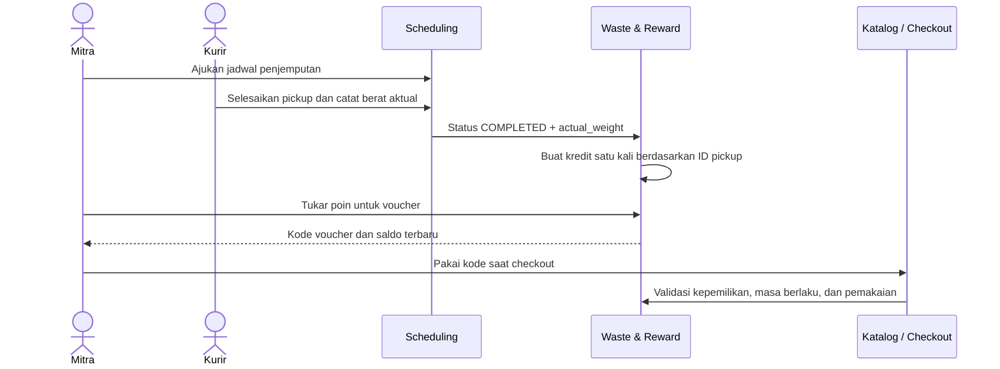

# Waste & Reward

Modul Waste & Reward mengelola saldo Waste Points mitra B2B, katalog voucher, riwayat reward, dan pemakaian voucher pada checkout GreenLoop.

## Fitur dan sumber data

| Area | Perilaku |
|---|---|
| Pickup menjadi poin | Pickup yang berstatus `COMPLETED` dan memiliki `actual_weight` membuat transaksi kredit dengan referensi pickup yang stabil. Penyimpanan ulang pickup tidak menggandakan poin. |
| Saldo dan tier | Saldo dihitung dari ledger `RewardTransaction`; tier Bronze, Silver, Gold, dan Platinum dihitung dari saldo. |
| Katalog voucher | Voucher aktif dapat ditukar mitra. Admin dapat menambah/mengubah voucher dan mengarsipkan voucher dengan aksi massal; voucher tidak dihapus permanen. |
| Voucher milik mitra | Kode voucher unik, kedaluwarsa, terikat ke akun pemilik, dan hanya dapat dipakai satu kali. |
| Checkout | Katalog memvalidasi ulang voucher, harga, stok, ongkir, dan jenis order di server sebelum menyimpan pesanan. |

Pickup dan berat aktual berasal dari aktivitas mitra/kurir di aplikasi. Katalog voucher awal ditambahkan oleh migration `0001_initial.py`; transaksi reward dan voucher yang sudah dimiliki pengguna tersimpan di database aplikasi. Modul ini tidak mengimpor dataset sampah dari API eksternal.

## Alur operasional



## Aturan poin dan saldo

- Konversi: 5 poin per kilogram. Berat dibulatkan ke bawah sampai 0,1 kg sebelum perhitungan; hasil poin juga bilangan bulat dengan pembulatan ke bawah.
- Berat aktual positif yang dibulatkan ke 0,0 kg tetap tercatat sebagai pickup, tetapi menghasilkan 0 poin.
- Hanya role `mitra` yang dapat memperoleh atau menukar poin. Dashboard dan endpoint mitra lain menerima 403; pengguna anonim diarahkan ke login.
- Referensi pickup harus stabil dan unik. Pemanggilan ulang untuk pickup yang sama mengembalikan transaksi yang sama.
- Ledger adalah sumber saldo utama. `PickupSchedule.points` hanya disinkronkan untuk kompatibilitas riwayat pickup.
- Penukaran membuat `UserVoucher` dan transaksi debit dalam transaksi database yang sama. Saldo tidak boleh menjadi negatif.

## Voucher dan keamanan

- Jenis voucher: diskon nominal, potongan ongkir, dan diskon grosir B2B.
- Voucher tidak dapat dipakai akun lain, kedaluwarsa, atau dipakai ulang. Voucher grosir memerlukan order mitra B2B.
- Endpoint penukaran menerima POST saja dan membatasi 10 percobaan per akun per menit.
- `RewardTransaction` dan `UserVoucher` read-only di admin untuk melindungi ledger; `RewardVoucher` dinonaktifkan/diarsipkan alih-alih dihapus.
- Database menolak biaya voucher atau masa berlaku nol, serta transaksi ledger yang tidak cocok dengan jenisnya.
- Rate limit memakai cache Django. Konfigurasi lokal bawaan Django menggunakan cache per proses; deployment multi-worker sebaiknya memakai backend cache bersama agar batas berlaku lintas worker.

## Penukaran dan pengalaman dashboard

Dashboard ada di `/mitra/waste-reward/`. Halaman menampilkan saldo, tier, aturan konversi, katalog voucher aktif, riwayat dengan filter/paginasi, dan voucher milik mitra.

Form penukaran memakai AJAX untuk memperbarui saldo, progres tier, voucher baru, dan riwayat tanpa reload. Form POST biasa tetap menjadi fallback jika JavaScript tidak tersedia. File interaksi berada di `static/js/waste_reward.js`.

Screenshot berikut dibuat dari UI aplikasi lokal dengan database demo terisolasi. Saldo, username, transaksi, dan kode voucher di dalamnya bukan data produksi. Gambar adalah capture browser dari UI aplikasi, bukan mockup buatan AI.

### Dashboard Mitra


### CRUD katalog voucher di Django Admin


## Setup lokal

Jalankan dari root repository:

```powershell
py -3 -m venv env
.\env\Scripts\Activate.ps1
python -m pip install -r requirements.txt
python manage.py migrate
python manage.py createsuperuser
python manage.py runserver
```

Buka `http://127.0.0.1:8000/`, lalu masuk memakai akun role `mitra` untuk mengakses dashboard Waste & Reward. Migration awal membuat voucher katalog bawaan. Admin mengelola katalog voucher lewat Django Admin.

Dashboard Waste & Reward tidak memerlukan kunci layanan eksternal. Pemakaian voucher saat checkout memerlukan konfigurasi Midtrans dan RajaOngkir; lihat [setting proyek](../greenloop/settings.py) dan jangan menyimpan `.env` atau kredensial di Git. Sebelum deployment baru, periksa konfigurasi `DEBUG`, secret key, database, dan shared cache.

## Tes dan coverage

```powershell
python manage.py test waste_reward
```

Untuk mengukur coverage lokal, pasang `coverage` di virtualenv (paket ini tidak wajib untuk menjalankan aplikasi):

```powershell
python -m pip install coverage
python -m coverage run --source=waste_reward manage.py test waste_reward
python -m coverage report -m
```

## Pengungkapan penggunaan AI

OpenAI Codex (GPT-6) digunakan sebagai asisten pada pengerjaan modul ini untuk meninjau struktur kode, mengusulkan perubahan, menyusun tes, memeriksa hasil tes/coverage, dan membantu dokumentasi. Strategi yang digunakan: memberi rubric sebagai kriteria, meminta pemeriksaan implementasi yang ada, lalu melakukan perubahan kecil dan menjalankan tes.

AI bisa salah memahami alur bisnis dan tidak mengetahui kredensial atau perilaku layanan produksi. Pemeriksaan iteratif menemukan dan mengoreksi sinkronisasi poin di riwayat pickup, kasus berat kecil yang menghasilkan 0 poin, progres Platinum setelah penukaran, dan pemulihan penghitung rate limit. Tes memverifikasi backend dan respons endpoint; interaksi AJAX belum diuji lewat browser otomatis dan layanan eksternal tidak diuji dengan kredensial produksi. Kode tetap perlu review dan demo manual.

Dokumentasi visual berisi capture dashboard mitra dan Django Admin di `docs/images/`. Belum ada GIF proses penukaran; alurnya dijelaskan pada diagram di atas. Untuk menangkap GIF yang aktual, jalankan aplikasi lokal, login sebagai mitra demo, lalu rekam interaksi penukaran voucher.
